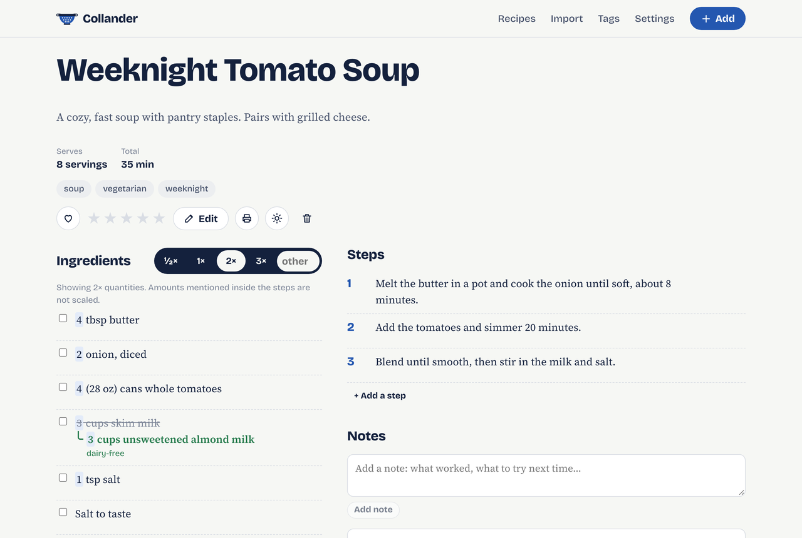
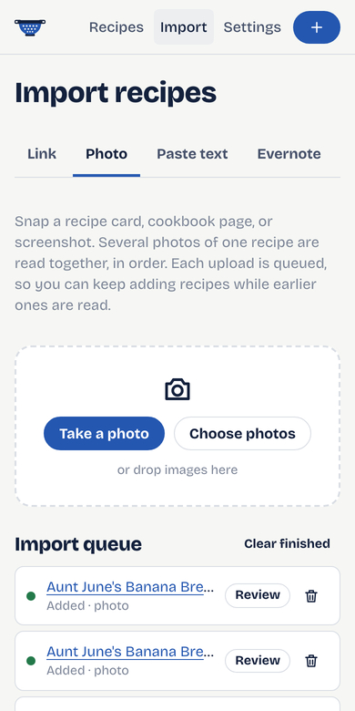

<p align="center">
  
</p>

<h1 align="center">Collander</h1>

<p align="center">A self-hosted recipe box that keeps the original recipe and your changes side by side.</p>

<p align="center">
  
</p>

## What it does

- **Add recipes by hand, or import them.** Paste a link, snap a photo of a recipe card, paste text, or bring over an Evernote export. Imports run in a background queue, so you can send one photo after another from your phone without waiting.
- **Change a recipe without losing the original.** Mark any ingredient or step as changed ("skim milk" → "almond milk", *dairy-free*), left out, or added. The original stays visible, crossed out, with your version beneath it.
- **Scale with one tap.** ½×, 1×, 2×, 3× or any multiplier. Quantities like `1 1/2`, `½`, `2-3` and `1 (14 oz) can` are scaled and shown as kitchen fractions; lines like "salt to taste" are left alone.
- **Notes.** Add dated notes to any recipe: what worked, what to try next time.
- **Tags, chosen by AI or by you.** The AI suggests tags and prefers tags you already use, so your vocabulary stays tidy. Rename or merge tags any time.
- **Fast search.** Full-text search across titles, ingredients (original and modified), steps, notes and tags, ranked by relevance. See [search syntax](#search).
- **Your choice of AI, or none.** Anthropic Claude, OpenAI (or any OpenAI-compatible server), Google Gemini, or a local model through Ollama. Everything except photo import works without AI.
- **Kitchen-friendly.** Works on phones, checks off ingredients and steps as you go, and prints cleanly. When served over HTTPS it can also be installed as an app (PWA), receive links shared from other apps, and keep the screen awake while you cook.
- **One container, one volume.** SQLite and images live in a single data volume that is easy to back up. A one-click JSON backup is built in.

<p align="center">
  
</p>

## Quick start (Docker Compose)

```bash
git clone <your-fork-or-this-repo> collander
cd collander
cp .env.example .env        # optional: edit to taste
docker compose up -d --build
```

Open <http://localhost:8080>, choose a password, and you're in. To use AI imports, open **Settings → AI model** and pick a provider.

Data is stored in the `collander-data` Docker volume. To keep it in a folder instead, change the volume line in `docker-compose.yml` to `- ./data:/data` and make sure the folder is writable by UID 1000.

### Updating

```bash
git pull
docker compose up -d --build
```

Database migrations run automatically on start.

## Configuration

All settings are optional environment variables (put them in `.env`). AI settings can also be changed on the Settings page; values set in the environment take precedence for API keys and are never stored in the database.

| Variable | Default | Purpose |
| --- | --- | --- |
| `COLLANDER_PORT` | `8080` | Host port (compose only) |
| `COLLANDER_PASSWORD` | – | Login password. If unset, you choose one on first visit. |
| `COLLANDER_SECURE_COOKIES` | `false` | Set `true` when served over HTTPS |
| `COLLANDER_SESSION_DAYS` | `30` | How long a sign-in lasts |
| `COLLANDER_QUEUE_WORKERS` | `2` | Imports processed in parallel |
| `COLLANDER_AI_PROVIDER` | `none` | `none`, `anthropic`, `openai`, `google`, `ollama` |
| `COLLANDER_AI_MODEL` | provider default | Model name |
| `COLLANDER_ANTHROPIC_API_KEY` | – | Claude API key |
| `COLLANDER_OPENAI_API_KEY` | – | OpenAI API key |
| `COLLANDER_OPENAI_BASE_URL` | – | For OpenAI-compatible servers (LM Studio, vLLM, OpenRouter…) |
| `COLLANDER_GOOGLE_API_KEY` | – | Gemini API key |
| `COLLANDER_OLLAMA_BASE_URL` | `http://host.docker.internal:11434` | Ollama address |
| `COLLANDER_DATA_DIR` | `/data` | Where the database and images live |
| `COLLANDER_MAX_UPLOAD_BYTES` | 512 MB | Largest accepted upload (ENEX, bundles) |

### AI providers

| Provider | Default model | Notes |
| --- | --- | --- |
| Anthropic | `claude-opus-5-5` | Uses structured outputs; refusals fall back to another Claude model automatically. |
| OpenAI | `gpt-5-mini` | Any OpenAI-compatible endpoint works through the base URL. |
| Google | `gemini-2.5-flash` | |
| Ollama | `llama3.1` | For photo import, pick a vision model such as `llama3.2-vision` or `qwen2.5vl`. |

Model names change often; set the one you want on the Settings page. Use **Test connection** to check it.

**Ollama on the same machine:** the default address `http://host.docker.internal:11434` reaches Ollama running on the Docker host (the compose file maps it on Linux too). Or run Ollama in the same stack with `docker compose --profile ollama up -d` and set the address to `http://ollama:11434`.

## Importing

| Source | How |
| --- | --- |
| **Link** | Import → Link. Collander reads the page's schema.org recipe data when it exists, and otherwise has the AI read the page. Some sites block automated requests; copy the text and use **Paste text** instead. When Collander is installed as an app over HTTPS on Android, you can share a link from your browser straight to it. |
| **Photo** | Import → Photo. Take or choose one or more photos of a single recipe (pages in order). Each upload is queued. Results are saved with a **Needs review** badge, and the original photos are shown on the recipe page until you mark it reviewed. |
| **Pasted text** | Import → Paste text. AI structures it; without AI, headings like "Ingredients" and "Directions" are used. |
| **Evernote** | In Evernote, export notes or a notebook as `.enex`. Import → Evernote, upload the file, pick the notes that are recipes (likely recipes are pre-selected), and start. Notes that are just a photo are read from the photo when AI is on. Re-running skips recipes already imported. |
| **Backup / bundle** | Import → Backup file. Accepts Collander backups and any file in the [bundle format](docs/bundle-format.md), which is handy for one-off migrations such as recipes collected from Google Docs. |

### AI check

An optional pass that runs your AI model over recipes to **tidy formatting and flag problems**. It is available as a checkbox on **Import → Backup file**, as an **AI check** button on each recipe, and under **Settings → Check recipes with AI** for every recipe that needs review, or all of them.

- It removes leftover web or OCR clutter (checkbox glyphs, step numbers, link markup), splits or joins mangled lines, moves stray ingredients or steps to the right list, and suggests tags.
- It never changes quantities, units or wording. If a suggested cleanup changes any number or drops text, it is rejected and the original kept. Lines carrying your modifications are never rewritten.
- Problems it can't fix itself, such as an ingredient used in a step but missing from the list, are added as an "AI check" note and the recipe is marked **Needs review**.
- When it does tidy lines, the before-version is saved under "Original imported text".

Large files can also be imported from the command line inside the container:

```bash
docker compose cp ./export.enex collander:/data/export.enex
docker compose exec collander python -m app.cli import-enex /data/export.enex --ai --tag evernote
docker compose exec collander python -m app.cli import-bundle /data/recipes.json --ai-check
docker compose exec collander python -m app.cli ai-check            # recipes needing review
```

## Search

Type in the search box on the recipe list. Words are matched by prefix and stem ("tomato" finds "tomatoes"), and all words must match.

| Query | Finds |
| --- | --- |
| `chicken curry` | recipes mentioning both words |
| `"brown butter"` | the exact phrase |
| `soup -cream` | soups that don't mention cream |
| `tag:vegetarian` / `-tag:spicy` | with / without a tag |
| `is:favorite`, `is:modified`, `is:review` | favorites, recipes you've changed, imports waiting for review |
| `in:title pie` | words in a specific field (`title`, `ingredients`, `tags`, `body`) |

Title and tag matches rank above ingredient matches, which rank above matches in steps and notes.

## Backups

Settings → **Download backup** saves every recipe, note, modification, tag and photo as one JSON file. Restore it with Import → Backup file. You can also back up the Docker volume directly; it contains `collander.db` (SQLite) and the `images/` folder.

```bash
docker compose exec collander python -m app.cli export /data/backup.json
```

## Command line

```bash
docker compose exec collander python -m app.cli --help
```

`import-bundle`, `import-enex`, `ai-check`, `export`, `reindex` (rebuild search) and `set-password`.

## Development

Requirements: Python 3.12+ with [uv](https://docs.astral.sh/uv/), Node 20+.

```bash
# Backend (http://localhost:8000)
cd backend
uv sync
COLLANDER_DATA_DIR=./data uv run uvicorn app.main:app --reload

# Frontend (http://localhost:5173, proxies /api to the backend)
cd frontend
npm install
npm run dev
```

Tests: `cd backend && uv run pytest` and `cd frontend && npm test`. See [CONTRIBUTING.md](CONTRIBUTING.md).

### How it's built

- **Backend:** FastAPI, SQLAlchemy and Alembic on SQLite, with an FTS5 index for search. Imports go through one schema (`RecipeIn`), whether they come from the editor, a web page, AI, Evernote or a bundle.
- **AI layer:** `backend/app/services/ai/` has one small interface ("give me JSON matching this schema, optionally from these images") with Anthropic, OpenAI, Google and Ollama backends. Responses are validated and retried once if they don't match.
- **Queue:** photo, link and text imports are stored first and processed by background worker threads, so requests return immediately. Items interrupted by a restart are picked up again.
- **Frontend:** React and Vite, with no UI framework. Scaling happens in the browser (`frontend/src/scale.ts`); the stored recipe is never changed by scaling.

## License

[MIT](LICENSE)
